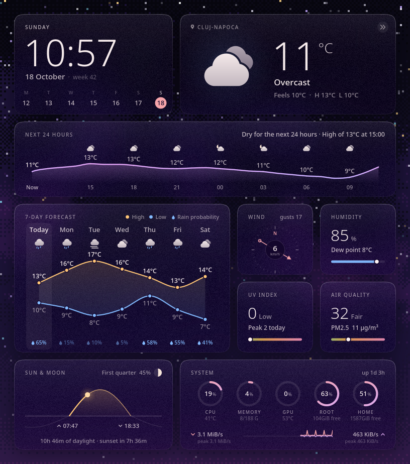
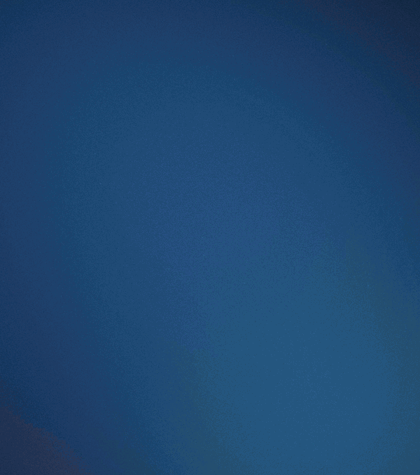
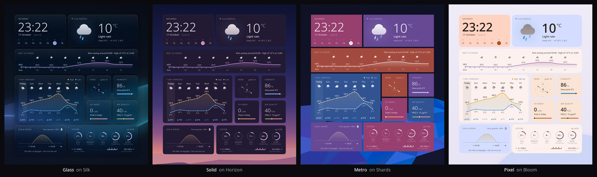
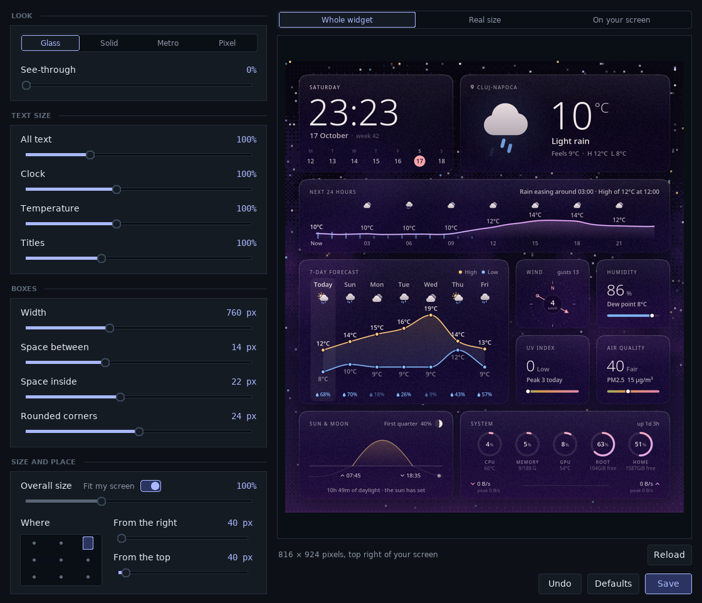
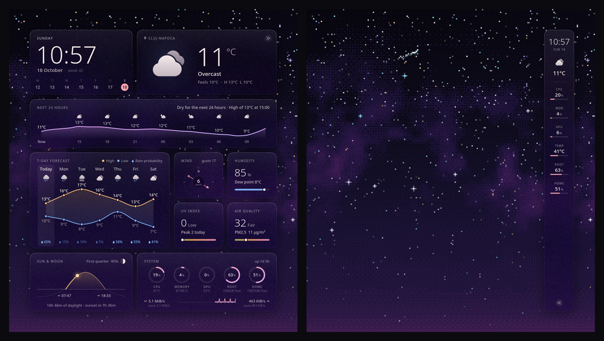
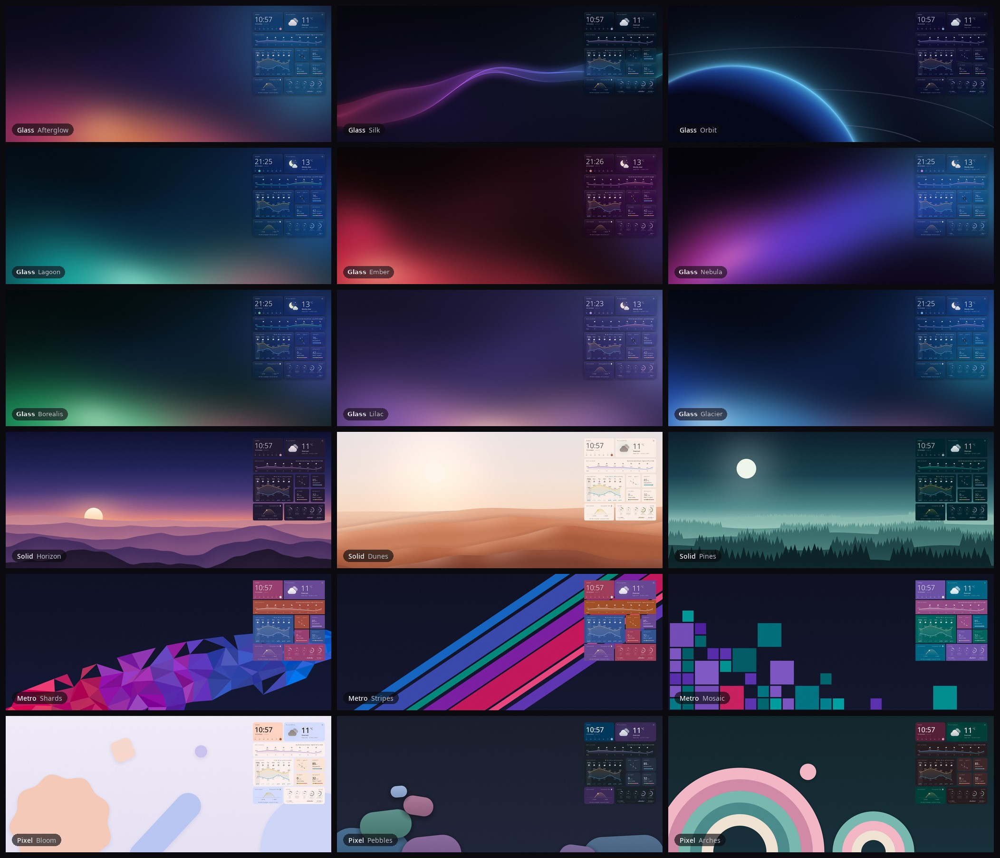

# Conky Mirage

A weather and system widget for Conky that takes its look from your wallpaper.



Each box is a blurred piece of the wallpaper behind it, and the colours come from
the wallpaper too. Change your wallpaper and the widget follows a couple of
seconds later.



It shows the time, the weather now, the next 24 hours and the next 7 days, wind,
humidity, UV, air quality, sunrise and sunset, the moon, and your CPU, memory,
GPU, disks and network.

The weather comes from [Open-Meteo](https://open-meteo.com/), so there's no API
key to sign up for. It finds your location on its own.

## What you need

- Conky 1.10 or newer, built with Lua and cairo
- Python 3 with Pillow (`python3-pil` on Debian and Ubuntu, `python-pillow` on Arch)
- `xwininfo` and `xrandr`, which you most likely have already
- For the settings window: Lua, and Tkinter (`python3-tk` on Debian and Ubuntu)

It works on Wayland too.

## Run it

```bash
git clone https://github.com/alexsson-xexpanderx/Conky-themes.git
cd Conky-themes/Conky-Mirage
conky -c start_conky_mirage &
```

It shows up in the top right corner of your screen. If you start it again while
it's running, the new one takes over and the old one closes.

## Change it

To pick a different look, make it bigger or smaller, or move it, open the
settings window:

```bash
./mirage_settings.py
```

There are four looks: Glass, Solid, Metro and Pixel. Pick one, move the sliders,
check the preview, and click **Save**. The widget restarts with your changes. If
you change your wallpaper while the window is open, click **Reload** to update
the preview.





## Fold it away

Click the two small arrows in the top corner and the widget folds into a slim
strip at the edge of your screen, with the time, the weather and your
computer's numbers. The arrows at the bottom of the strip open it again. It
stays the way you leave it. In Metro and Pixel the strip is made of small
boxes in the same colours as the open widget. To see it folded in the
settings window, pick Folded above the preview.



## Wallpapers

There are eighteen wallpapers made for Mirage in `wallpapers`, three for each look,
and six more like Afterglow: soft pools of coloured light on a dark sky, in teal,
crimson, violet, green, lilac and ice blue. They suit Glass and Metro alike.



They come in 3440x1440 and 3840x2160. If your screen is another size, you can
make them for it first (you need numpy for this):

```bash
wallpapers/make_wallpapers.py --size 2560x1440
```

On KDE, copy them to your wallpaper folder and pick one in the wallpaper settings:

```bash
cp -r wallpapers/*/Mirage* ~/.local/share/wallpapers/
```

## Other settings

The rest is at the top of `mirage.lua`: your city, °C or °F, a 12 or 24
hour clock, which disks and boxes to show, and the fonts. Each setting has a short
note next to it. Restart Conky after you change something.

## If something looks wrong

Run `./mirage.py doctor`. It tells you which wallpaper and screen it found. There's
also a log in `~/.cache/conky-mirage/mirage.log`.

If your wallpaper is a slideshow, Mirage can't tell which picture is showing, so
the boxes stay plain see-through glass. You can point it at a picture with the
`wallpaper` setting in `mirage.lua`.
