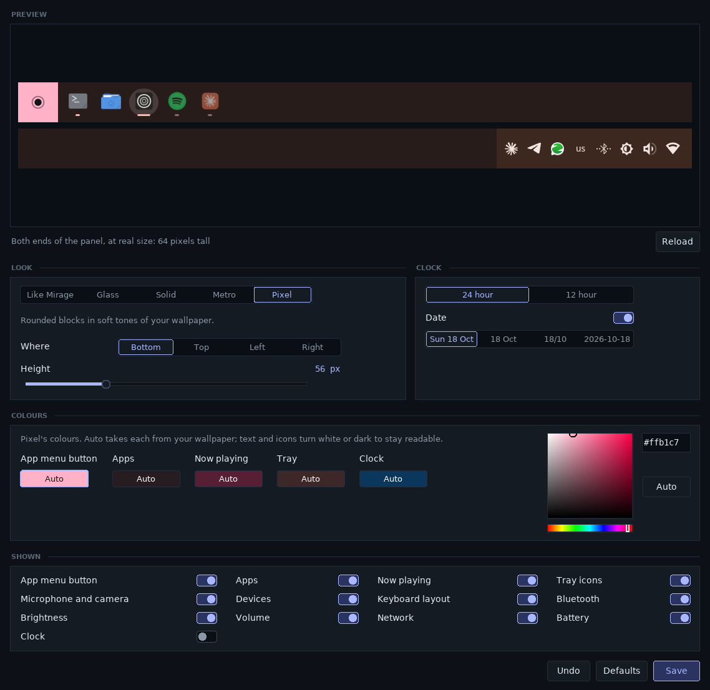

# ConkyTray

A panel for the edge of your screen, drawn by conky in the same four looks
as [Conky-Mirage](../Conky-Mirage): glass, solid, Metro and Pixel. It follows
whatever look Mirage is set to, and takes its colours from your wallpaper.

From left to right it has a button for the app menu, your pinned and open
apps, what is playing, the tray icons, volume, network, battery (on a laptop)
and the clock.
Windows keep clear of it, the way they do for Plasma's own panel. Like
Plasma's, it floats with a little room round it, and when a window is
maximised (or reaches the panel's edge) it grows to meet the edge of the
screen, with square ends. In Metro and Pixel the blocks then close up and
the apps' block runs all the way to the tray.

It is new and still being worked on.

## What you need

- KDE Plasma on Wayland. The panel uses a Wayland feature (the layer shell)
  that Plasma has and X11 does not.
- conky 1.25 or newer, built with Wayland and Lua support.
- Python 3 with dbus-python, PyGObject, pycairo and Pillow, GTK 3 with gtk-layer-shell
  (for the menus), and `rsvg-convert` (for the icons).
- Conky-Mirage in the folder next to this one, for the looks. Without it the
  panel still works, in plain dark colours.

## Start it

```bash
conky -c /path/to/ConkyTray/start_conky_tray
```

Your Plasma panel can stay while you try it: ConkyTray sits just above it.

## Using it

- **Apps:** click to open, to bring a window to the front, or to minimise it.
  With several windows, each click goes to the next. Middle-click opens a new
  window. Right-click to pin or unpin the app, or close its windows.
- **The button at the left:** opens the app menu, laid out like Plasma's.
  Your favourites, all your apps and their categories, a search box (just
  start typing), your folders under Places, and Lock, Log out, Sleep, Restart
  and Shut down. Right-click an app in it to add it to your favourites or pin
  it to the panel. Search for something that isn't an app and press Enter to
  hand it to KRunner.
- **Now playing:** while music or a video plays (Spotify, YouTube in your
  browser and so on), the song and the artist show in the middle of the
  panel, with the cover, a thin line for how far in you are, and buttons for
  the previous song, pause or play, and the next song. Click the cover or the
  title to bring the player up, scroll over it to skip, right-click for the
  rest. Beside the title, bars move with the sound while it plays. A paused
  song stays for ten minutes so you can carry on. The more apps you have open,
  the shorter it gets: first the bars go, then the artist, then the title is
  cut short, then only the buttons are left, and then only pause or play.
- **Tray icons:** click them as you would in Plasma's tray. Right-click for
  their menu.
- **Microphone and camera:** while an app is using your microphone or your
  camera, its icon shows with a red dot. Click it to see which app. When you
  share your screen, the screen sharing icon shows in the tray too.
- **Volume:** scroll over it to turn it up or down, click to mute.
- **Network:** click for the network settings.
- **Bluetooth:** click to turn it on or off, or to connect one of your
  devices. The ones that are connected have a tick.
- **Brightness:** scroll over it to make your screen brighter or darker.
- **Keyboard layout:** shows the layout you type in, such as "us". Click to
  switch to the next one, right-click to pick one, or scroll.
- **Devices:** appears while a USB drive or memory card is plugged in. When
  you plug one in, a small menu opens by itself to open it in the file
  manager or remove it safely, and goes away again after a few seconds.

The pinned apps are kept in `~/.config/conky-tray/pinned` and the menu's
favourites in `~/.config/conky-tray/favorites`, one per line. The first time,
both are copied from your Plasma panel and menu.

## Settings

```bash
./tray_settings.py
```

The settings window looks like Mirage's. Pick the look (or "Like Mirage", to
always match it), which edge of the screen the panel goes along (on the left
or right it stands upright), the clock, the date and how it is written,
and how thick the panel is. Every part of the panel can be turned off: the
app menu button, the apps, what is playing and its sound bars, the tray icons, the microphone
and camera warning, devices, the keyboard layout, Bluetooth, brightness,
volume, network, battery and the clock. The preview
shows both ends of the panel at real size. Save, and the panel changes right
away.

Under Colours you can give the look colours of your own instead of the ones
it takes from your wallpaper: the glass a tint and how see-through it is, the
solid bar one colour, and in Metro and Pixel each block its own (the app menu
button, your apps, what is playing, the tray and the clock). Click a colour,
then pick one or type its code; Auto puts the wallpaper's back. Text and
icons turn white or dark by themselves so they stay readable. Each look keeps
its own colours, so you can switch looks and come back.



The same settings are at the top of `tray.lua`, and the edge and the size
are in `start_conky_tray`, if you would rather edit them by hand.

## Replacing Plasma's panel

Once you are happy with it, start it with your desktop: add
`conky -c /path/to/ConkyTray/start_conky_tray` in System Settings under
Autostart. Then remove Plasma's panel (right-click it, "Show Panel
Configuration", and delete it there).

Plasma's tray has a few things ConkyTray does not have yet: the clipboard and
the list of past notifications. Notifications themselves still pop up as
before.
