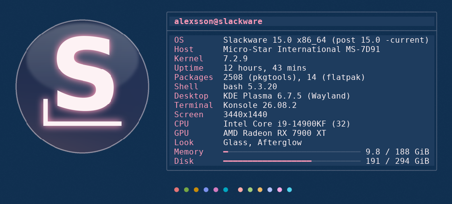
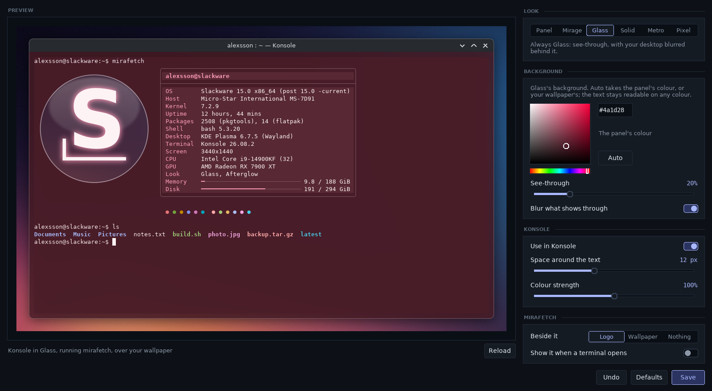
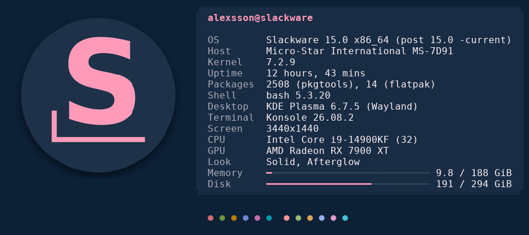
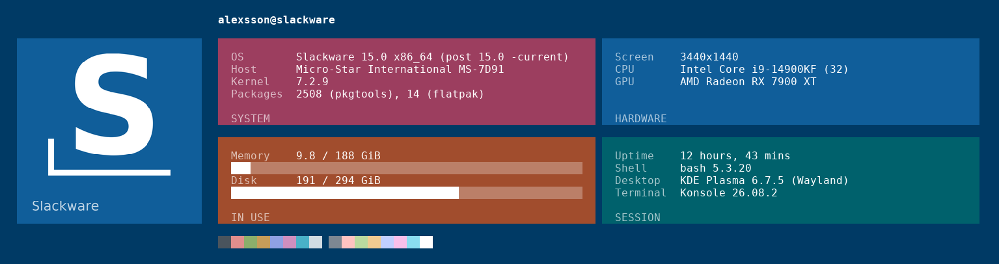
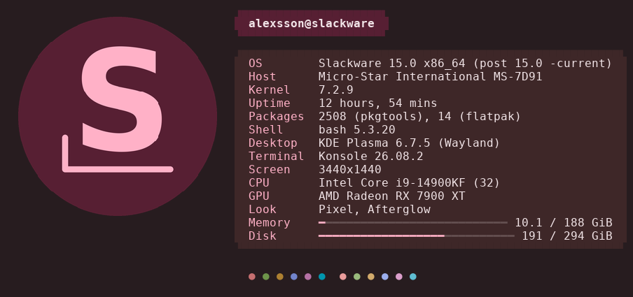

# Mirage-Terminal

Your terminal in the look of [Conky-Mirage](../Conky-Mirage) and
[ConkyTray](../ConkyTray): Konsole's colours follow the look and the
wallpaper, and `mirafetch` shows your system at a glance, beside your
system's logo drawn in the same look.



## Settings

```bash
./terminal_settings.py
```

A window with a preview of Konsole running mirafetch over your wallpaper.
Pick the look the terminal follows (the panel's, Mirage's, or one of its
own), its background colour, how much of your desktop shows through it and
whether that is blurred, the space around the text and how colourful the
colours are. You can also choose what mirafetch shows beside the facts and
have it run whenever you open a terminal. Nothing changes until you press
Save; then Konsole windows that are open change right away.



## Konsole

```bash
./mirage_konsole.py install
```

This makes a Konsole profile called Mirage and sets it as Konsole's default
(the "Use in Konsole" switch in the settings does the same). It is a copy of
the profile you had (your font, cursor and the rest), with the colours of
the look you have now. Konsole windows you open from then on use it.

While ConkyTray is running, Konsole changes with it: switch the look, change
the wallpaper or pick other colours in ConkyTray's settings, and every open
Konsole tab on the Mirage profile changes too, within a few seconds. Without
ConkyTray, run `./mirage_konsole.py apply` after a change.

Glass is see-through, with the desktop blurred behind it (KDE's blur effect
has to be on). Solid, Metro and Pixel are opaque unless you say otherwise,
in the colour of the panel's bar, its apps block and its surface. The
sixteen terminal colours keep their meaning (red is still red), turned a
little towards the wallpaper's colours and always readable on the
background.

To go back to the profile you had before:

```bash
./mirage_konsole.py uninstall
```

## mirafetch

```bash
./mirafetch
```

What you are running (system, kernel, desktop, shell, CPU, GPU, memory and
disk) next to your system's logo, drawn the way the look draws: a glass
disc, a solid one, a Metro tile or Pixel's soft tonal one. Slackware has its
own logo; other systems get the first letter of their name for now.
`mirafetch --beside wallpaper` shows the wallpaper instead, `--beside none`
nothing, and `mirafetch --look metro` shows another look. In Konsole the
logo is a real picture; in other terminals it is drawn with blocks.

To run it from anywhere, link it into a folder on your PATH:

```bash
ln -s "$PWD/mirafetch" ~/.local/bin/mirafetch
```

| Glass | Solid |
|---|---|
|  |  |
| **Metro** | **Pixel** |
|  |  |

## What you need

Conky-Mirage in the folder next to this one (the colours come from it),
Python 3 with Pillow and Tk, and for Konsole dbus-python. Konsole 22.04 or
newer shows the logo as a picture. Every setting is also at the top of
`terminal_palette.py`, if you would rather edit them there.
